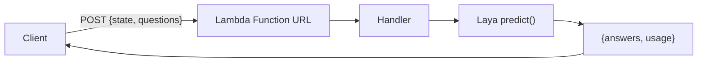

# laya-on-aws-lambda

[](https://opensource.org/licenses/MIT)

Run [Laya](https://huggingface.co/convaiinnovations/laya), an open-weight, non-autoregressive "System 1" decision model, on AWS Lambda. This repo is a Jev-compatible decision API: a single Lambda function takes a state and typed questions and returns calibrated answers. TypeScript and Python variants included.

Laya never generates text. Give it a state (text, email, ticket, or JSON) and typed questions (`choice`, `score`, `noul`), and it answers in one forward pass with calibrated probabilities. The response matches TypeSafe's hosted Jev API (`{ answers, usage }`), so a Jev client works by changing its base URL.

## How it works

The client POSTs `{ state, questions }` to a Lambda Function URL. The handler runs Laya and returns the answers.



Both variants return the same answer for the same input. `plain/typescript` runs Laya through `laya-ts` (ONNX Runtime, fp32); `plain/python` runs the reference PyTorch runtime. Each is self-contained with its own SAM template, Dockerfile, and dependency manifest.

The model is baked into the container image. There is no runtime download, no S3 or EFS, and no init-time network call.

## Prerequisites

- [AWS SAM CLI](https://docs.aws.amazon.com/serverless-application-model/latest/developerguide/install-sam-cli.html) 1.153.1 or later
- Docker (running)
- Node.js, to build `laya-ts` from source during the export
- Python 3.10-3.13 with `torch` for the one-time model export (`torch` has no 3.14 wheels yet)
- AWS credentials configured (`AWS_PROFILE` or default)

## Getting started

```bash
git clone https://github.com/gunnargrosch/laya-on-aws-lambda.git
cd laya-on-aws-lambda

# one-time: build the model artifacts (see "Design decisions" for why this is separate)
PYTHON=python3.12 ./scripts/export.sh

# deploy a variant
cd plain/typescript && ./deploy.sh
```

`./deploy.sh` builds and deploys for your machine's architecture, prints the Function URL, and uses your default AWS profile and region. Pass `--profile <p> --region <r>` to override.

## Deploy

Container images are single-architecture, and `sam build` builds for the host, so `./deploy.sh` detects the host architecture and passes the matching `LambdaArchitecture` parameter. A Mac (arm64) and an x86 machine both work with no extra steps.

Use the script rather than `sam build` and `sam deploy` by hand. If you deploy manually, set `LambdaArchitecture` to match your machine (`x86_64` or `arm64`).

```bash
cd plain/typescript && ./deploy.sh     # or: cd plain/python && ./deploy.sh
```

To keep environments warm and remove the cold start, enable provisioned concurrency (off by default):

```bash
PROVISIONED_CONCURRENCY=1 ./deploy.sh
```

This allocates provisioned concurrency on the `live` alias, which the Function URL points at, and adds cost while allocated.

Then call the Function URL from the stack output:

```bash
curl -s "$FUNCTION_URL" -H 'content-type: application/json' -d '{
  "state": { "body": "We were billed twice for March. Refund the duplicate today or we cancel." },
  "questions": {
    "department": {
      "type": "choice",
      "instructions": "Which department should handle this?",
      "criteria": { "billing": "invoices, payments, refunds", "technical": "bugs, outages", "other": "everything else" }
    },
    "urgency": { "type": "score", "instructions": "How urgent?", "criteria": ["not urgent", "soon", "blocking"] },
    "churn": { "type": "noul", "instructions": "Does the customer threaten to cancel?" }
  }
}'
```

```json
{ "answers": { "department": { "choice": "billing", "answer_confidence": 0.9863 } }, "usage": { "input_tokens": 157, "output_tokens": 0 } }
```

The Function URL uses `AuthType: NONE` so the quickstart works with plain `curl`. Put AWS_IAM auth, an API key, or a WAF in front before exposing it.

## Test

Unit tests cover the pure request and decision logic, so they need no model and no AWS.

```bash
cd plain/typescript && npm test      # node --test
cd plain/python && python -m pytest
```

## Project structure

```text
scripts/
  export.sh                # build the model artifacts for every variant (one-time)
plain/
  typescript/              # Jev-compatible API, laya-ts (fp32 ONNX), Function URL
    src/                   # handler + request parsing
    template.yaml          # SAM template (Lambda, Function URL)
    Dockerfile
    deploy.sh              # build + deploy for the host architecture
  python/                  # Jev-compatible API, laya (PyTorch), Function URL
    src/
    template.yaml
    Dockerfile
    deploy.sh
```

## Design decisions

**Lazy model load.** Lambda caps the init phase at 10 seconds. Loading the model at module scope blows that cap, so the handler loads it on the first invoke and caches it. The load then runs under the function timeout instead of the init timeout.

**fp32, not INT8.** Quantizing the TypeScript model to INT8 produced correct results on a workstation but wrong (uniform) results on Lambda's x86 CPUs, which points at an ONNX Runtime kernel path. The sample ships fp32. See [onnxruntime-int8-on-lambda](docs/onnxruntime-int8-on-lambda.md) and the standalone repro at [onnxruntime-int8-lambda-repro](https://github.com/gunnargrosch/onnxruntime-int8-lambda-repro).

**PyTorch for the Python variant.** The `laya` package's ONNX export fails for multi-question batches at runtime, so the Python variant uses the reference PyTorch path (`laya.load`) and bakes the checkpoint instead.

**`laya-ts` vendored.** `laya-ts` is not published to npm, so `export.sh` builds it from source and vendors it into the TypeScript variant.

## Limitations

- **Cold start.** The image is large (the fp32 ONNX encoder is ~1.5 GB), so the first invocation reads the model from the image and can take tens of seconds. Warm invocations respond in about a second.
- **Model export step.** The artifacts (~1.6 GB) are gitignored, so `scripts/export.sh` runs once after cloning.
- **Zero-shot accuracy.** Base checkpoints are near chance on domain-specific decisions. Routing, triage, and guardrail classification are the sweet spot. Refit calibration temperatures on your own data before trusting `answer_confidence`.
- **Option count.** `choice` questions degrade past ~20 options.

## Cost

Lambda compute per request is negligible (hundreds of milliseconds on CPU), and there is no per-token cost because the model is self-hosted. For comparison, Jev's hosted API is metered at $0.042 per 1M input tokens.

## Production considerations

This is a demo. If you use it as a starting point:

- **Provisioned Concurrency.** Set `PROVISIONED_CONCURRENCY` (see Deploy) to keep environments warm and remove the cold start.
- **Auth.** The Function URL is unauthenticated by default. Add AWS_IAM or an API key.
- **Calibration.** Fit temperature per question type on your data before branching on confidence.
- **Model updates.** Bump `CHECKPOINT`/`REVISION` in `scripts/export.sh`, re-export, and redeploy.

## Clean Up

```bash
sam delete --stack-name laya-decision-api-ts   # or laya-decision-api-py
```

## Contributing

Contributions are welcome. Please open an issue or submit a pull request.

## License

[MIT](LICENSE)
