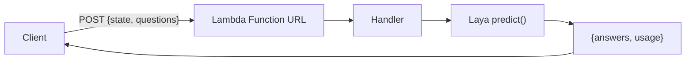

# laya-on-aws-lambda

[](https://opensource.org/licenses/MIT)

Run [Laya](https://huggingface.co/convaiinnovations/laya), an open-weight, non-autoregressive "System 1" decision model, on AWS Lambda. This repo is a Jev-compatible decision API: a single Lambda function takes a state and typed questions and returns an answer with a probability for each one. There are TypeScript and Python variants.

Laya never generates text. Give it a state (text, email, ticket, or JSON) and typed questions (`choice`, `score`, `noul`), and it answers in one forward pass. The request and response follow TypeSafe's hosted Jev API (`{ state, questions }` in, `{ answers, usage }` out), and the handler ignores the path and auth headers, so a Jev client should work by changing its base URL. I've only tested it with `curl`.

The probabilities are only as good as the calibration behind them. Fit calibration on your own labeled data before you branch on them (see Limitations).

## How it works

The client POSTs `{ state, questions }` to a Lambda Function URL. The handler runs Laya and returns the answers.



Both variants return the same answer for the same input. `plain/typescript` runs Laya through `laya-ts` (ONNX Runtime, fp32); `plain/python` runs the reference PyTorch runtime. Each is self-contained with its own SAM template, Dockerfile, and dependency manifest.

The model is baked into the container image, so the function makes no network calls to load it.

## Prerequisites

- [AWS SAM CLI](https://docs.aws.amazon.com/serverless-application-model/latest/developerguide/install-sam-cli.html) 1.153.1 or later
- Docker or [Finch](https://github.com/runfinch/finch), running
- AWS CLI, which `deploy.sh` uses to find the Function URL for the warm-up request
- Node.js, to build `laya-ts` from source during the export
- Python 3.10-3.13 for the one-time model export. `export.sh` picks the newest one on your `PATH`; set `PYTHON` to override
- AWS credentials configured (`AWS_PROFILE` or default)

## Getting started

```bash
git clone https://github.com/gunnargrosch/laya-on-aws-lambda.git
cd laya-on-aws-lambda

# one-time: build the model artifacts (see "Design decisions" for why this is separate)
./scripts/export.sh

# deploy a variant
cd plain/typescript && ./deploy.sh
```

`./deploy.sh` builds and deploys for x86_64, sends one warm-up request, and prints the Function URL. It uses your default AWS profile and region. Pass `--profile <p> --region <r>` to override.

## Deploy

```bash
cd plain/typescript && ./deploy.sh     # or: cd plain/python && ./deploy.sh
```

Both variants deploy **x86_64 by default**, on any machine. fp32 inference measured 2 to 4x slower on Lambda arm64, which runs on a mix of CPU generations: about 1.0 s warm on x86_64, 2.1 s on Graviton3, and 3.8 s on Graviton2 at 4096 MB, with identical answers. At those speeds arm64 costs more per request even at its lower price. To deploy the TypeScript variant to Graviton anyway:

```bash
LAMBDA_ARCHITECTURE=arm64 ./deploy.sh
```

The Python variant only deploys x86_64. PyTorch fails to initialize its `cpuinfo` library on Lambda arm64 ([pytorch/pytorch#113568](https://github.com/pytorch/pytorch/issues/113568)), so every request would fail.

Lambda container images are single-architecture. `sam build` builds for the architecture in the template, after any `--parameter-overrides` you pass to it, so on an Apple silicon Mac the x86_64 image builds under emulation. That's slower but works.

Use the script rather than `sam build` and `sam deploy` by hand. SAM keeps a parameter's previous value when you don't pass it, so a manual deploy after switching architectures can put an image built for one architecture on a function set to the other. The script passes `LambdaArchitecture` and `ProvisionedConcurrency` to both commands every time.

### Warm-up

After deploying, the script sends one small request to the Function URL and waits for it. The first request after a deploy can read the whole model from an image Lambda hasn't cached yet. In my testing that took 16 seconds to 2.5 minutes for TypeScript and about a minute for Python, depending on whether Lambda still had the model's image chunks from an earlier deploy. Later cold starts take 7 to 14 seconds. Set `SKIP_WARMUP=1` to skip it.

### Provisioned concurrency

Off by default. To enable it:

```bash
PROVISIONED_CONCURRENCY=1 ./deploy.sh
```

This allocates provisioned concurrency on the `live` alias, which the Function URL points at, and bills by the hour while allocated (about $0.06 an hour per environment at 4096 MB on x86_64). The handler loads the model and runs a throwaway prediction during init on provisioned environments, so the first request takes about 3.5 seconds and the rest about a second.

### Call it

Get `FUNCTION_URL` from the script's output or the stack's `FunctionUrl` output:

```bash
curl -s "$FUNCTION_URL" -H 'content-type: application/json' -d '{
  "state": { "body": "We were billed twice for March. Refund the duplicate today or we cancel." },
  "questions": {
    "department": {
      "type": "choice",
      "instructions": "Which department should handle this?",
      "criteria": { "billing": "invoices, payments, refunds", "technical": "bugs, outages", "other": "everything else" }
    },
    "urgency": { "type": "score", "instructions": "How urgent?", "criteria": ["not urgent", "soon", "blocking"] },
    "churn": { "type": "noul", "instructions": "Does the customer threaten to cancel?" }
  }
}'
```

Trimmed to one answer, the response looks like this:

```json
{ "answers": { "department": { "choice": "billing", "answer_confidence": 0.9863 } }, "usage": { "input_tokens": 157, "output_tokens": 0 } }
```

The full response also has `urgency` and `churn`, and each answer includes `probabilities`, an entropy-based `confidence`, and `answer_confidence`, the probability of the chosen answer.

The Function URL uses `AuthType: NONE` so the quickstart works with plain `curl`. Put AWS_IAM auth, an API key, or a WAF in front before exposing it.

## Test

Unit tests cover the pure request and decision logic, so they need no model and no AWS.

```bash
cd plain/typescript && npm test      # node --test
cd plain/python && python -m pytest
```

## Project structure

```text
scripts/
  export.sh                # build the model artifacts for every variant (one-time)
plain/
  typescript/              # Jev-compatible API, laya-ts (fp32 ONNX), Function URL
    src/                   # handler + request parsing
    template.yaml          # SAM template (Lambda, Function URL)
    Dockerfile
    deploy.sh              # build + deploy (x86_64 by default) + warm-up request
  python/                  # Jev-compatible API, laya (PyTorch), Function URL
    src/
    template.yaml
    Dockerfile
    deploy.sh
```

## Design decisions

### Lazy model load

Lambda caps the init phase at 10 seconds. Loading the model at module scope blows that cap, so the handler loads it on the first invoke and caches it. The load then runs under the function timeout instead of the 10-second init cap. On provisioned concurrency, where init isn't capped at 10 seconds, the handler loads the model during init instead.

### fp32 over INT8

Quantizing the TypeScript model to INT8 produced correct results on a workstation but wrong (uniform) results on Lambda x86. Lambda's x86 CPUs (every environment I checked in eu-north-1) expose AVX2 without VNNI, where ONNX Runtime's default U8S8 quantization saturates. `reduce_range=True` or uint8 weights fix that, but the full model still drifts too much (up to 0.5 on one answer), so the sample ships fp32. See [onnxruntime-int8-on-lambda](docs/onnxruntime-int8-on-lambda.md) and the standalone repro at [onnxruntime-int8-on-lambda](https://github.com/gunnargrosch/onnxruntime-int8-on-lambda).

### PyTorch for the Python variant

The `laya` package's ONNX export fails for multi-question batches at runtime, so the Python variant uses the reference PyTorch path (`laya.load`) and bakes the checkpoint instead.

### Vendored `laya-ts`

`laya-ts` is not published to npm, so `export.sh` builds it from source and vendors it into the TypeScript variant.

## Limitations

- The image is large (the fp32 ONNX encoder is ~1.5 GB). Once Lambda has cached it, cold starts take 7 to 8 seconds (TypeScript) or 10 to 14 seconds (Python). The first request after a deploy can take minutes, which `deploy.sh` absorbs with its warm-up request. Warm requests take about a second.
- The model artifacts (~1.6 GB) are gitignored, so `scripts/export.sh` has to run once after cloning.
- Base checkpoints are near chance on decisions that need business-specific knowledge. Generic routing, triage, and guardrail questions are where they do well. Refit calibration temperatures on your own data before trusting `answer_confidence`.
- `choice` questions degrade past about 20 options.

## Cost

Measured on x86_64 in eu-north-1 with the example request (157 input tokens): about $62 per 1M requests at 3072 MB and $66 at the default 4096 MB, including the request fee. Jev's hosted API is $0.042 per 1M input tokens, about $6.60 per 1M of the same request, so self-hosting on Lambda costs roughly 10x more per decision. Self-host for the open weights and to keep the data in your account. It won't save money.

## Production considerations

This is a demo. If you use it as a starting point:

- Set `PROVISIONED_CONCURRENCY` (see Deploy) to keep environments warm. The first request on each provisioned environment still takes a few seconds.
- The Function URL is unauthenticated by default. Add AWS_IAM or an API key, and set reserved concurrency as a cost ceiling.
- Fit calibration temperatures per question type on your data before branching on `answer_confidence`.
- To update the model, bump `CHECKPOINT` and `REVISION` in `scripts/export.sh`, re-export, and redeploy.

## Troubleshooting

### `export.sh needs Python 3.10-3.13`

The export found no supported Python on your `PATH`. Install one (for example `brew install python@3.12`) and run `./scripts/export.sh` again. It picks the newest supported version and removes a `.venv` built with an older one.

### `Runtime.InvalidEntrypoint` or `ProcessSpawnFailed` on every request

The image was built for a different architecture than the function runs on, usually after running `sam build` and `sam deploy` by hand without `LambdaArchitecture`. Run `./deploy.sh` again, or pass the same `LambdaArchitecture` to both commands.

### `Failed to initialize cpuinfo!` in the Python variant's logs

The Python variant is running on arm64, where PyTorch can't start. Deploy it with `plain/python/deploy.sh`, which always uses x86_64.

### `Token has expired and refresh failed` from SAM

Your SSO session expired. Run `aws sso login` again. If the AWS CLI works but SAM still fails, export the CLI's credentials into your shell and deploy from there:

```bash
eval "$(aws configure export-credentials --format env)"
```

### `no space left on device` during the build

Docker or Finch ran out of disk inside its VM. Each image here is several GB. Remove unused images with `docker system prune -a` (or `finch system prune --all`) and build again.

## Clean Up

```bash
sam delete --stack-name laya-decision-api-ts   # or laya-decision-api-py
```

## Contributing

Issues and pull requests are welcome.

## License

[MIT](LICENSE)
